# Réseau d'entreprise segmenté : VLAN, routage inter-VLAN, DHCP, ACL et SSH

Simulation sous **Cisco Packet Tracer** d'un réseau à deux services : la Direction (VLAN 10) et les Ressources humaines (VLAN 20). Objectifs : isoler les services, les faire communiquer par un routeur, distribuer les adresses automatiquement, sécuriser l'administration par SSH et interdire la communication entre deux postes précis (PC1 vers PC4).

**Page du projet :** [https://yves-guidebe.github.io/projet-vlan-packet-tracer/](https://yves-guidebe.github.io/projet-vlan-packet-tracer/)
**Autre projet :** [Lab MikroTik et Alpine Linux](https://yves-guidebe.github.io/lab-mikrotik-alpine/)

## Matériel simulé
1 routeur 2911 (r1), 2 switches 2960 (sw1, sw2), 4 postes, 2 VLAN.

## Plan d'adressage
| Poste | VLAN | Adresse (DHCP) | Passerelle |
|---|---|---|---|
| PC1 | 10, Direction | 192.168.10.2 | 192.168.10.1 |
| PC3 | 10, Direction | 192.168.10.3 | 192.168.10.1 |
| PC4 | 20, RH | 192.168.20.2 | 192.168.20.1 |
| PC2 | 20, RH | 192.168.20.3 | 192.168.20.1 |
| sw1 (gestion SSH) | 10 | 192.168.10.5 | 192.168.10.1 |

## Configuration
**Switch (exemple sw1)**
```
vlan 10
 name dir
vlan 20
 name rh
interface fa0/1
 switchport mode trunk
interface fa0/2
 switchport mode access
 switchport access vlan 10
interface fa0/3
 switchport mode access
 switchport access vlan 20
```

**Routeur : routage inter-VLAN (router-on-a-stick)**
```
interface g0/0
 no shutdown
interface g0/0.10
 encapsulation dot1Q 10
 ip address 192.168.10.1 255.255.255.0
interface g0/0.20
 encapsulation dot1Q 20
 ip address 192.168.20.1 255.255.255.0
```

**DHCP (un pool par VLAN)**
```
ip dhcp pool VLAN10
 network 192.168.10.0 255.255.255.0
 default-router 192.168.10.1
ip dhcp pool VLAN20
 network 192.168.20.0 255.255.255.0
 default-router 192.168.20.1
```

**SSH (administration sécurisée du switch)**
```
interface vlan 10
 ip address 192.168.10.5 255.255.255.0
 no shutdown
ip default-gateway 192.168.10.1
ip domain-name exemple.local
username admin secret ********
crypto key generate rsa modulus 2048
ip ssh version 2
line vty 0 4
 login local
 transport input ssh
```

**ACL : interdire PC1 vers PC4** (en entrée sur la sous-interface du VLAN 10)
```
ip access-list extended bloquer-pc1-pc4
 10 deny ip host 192.168.10.2 host 192.168.20.2
 20 permit ip any any
interface g0/0.10
 ip access-group bloquer-pc1-pc4 in
```

## Preuves de fonctionnement

### Couche 2 : VLAN et trunk

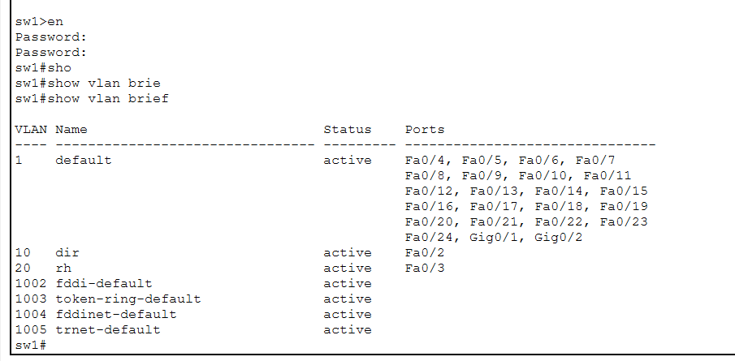
*sw1 : VLAN 10 « dir » sur Fa0/2, VLAN 20 « rh » sur Fa0/3 (`show vlan brief`).*

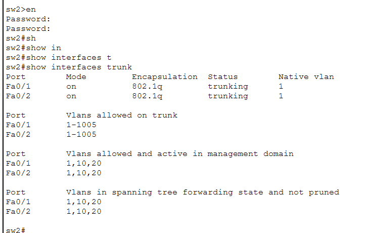
*sw2 : trunks 802.1Q actifs sur Fa0/1 et Fa0/2, VLAN 1, 10 et 20 transportés (`show interfaces trunk`).*

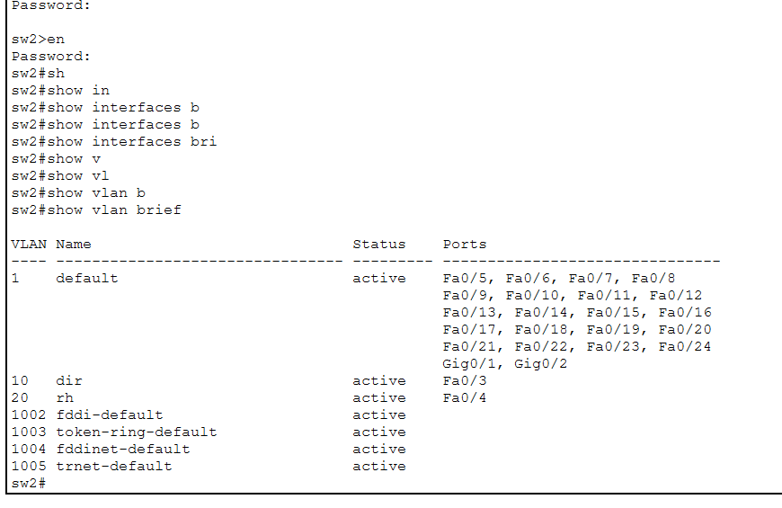
*sw2 : VLAN 10 sur Fa0/3, VLAN 20 sur Fa0/4 (`show vlan brief`).*


### Routage et DHCP

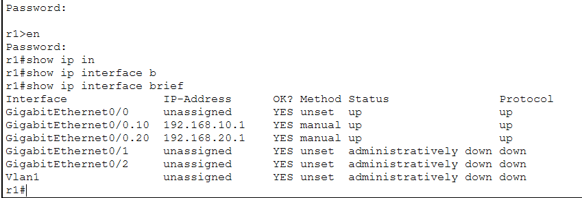
*r1 : sous-interfaces g0/0.10 et g0/0.20 en up/up (`show ip interface brief`).*

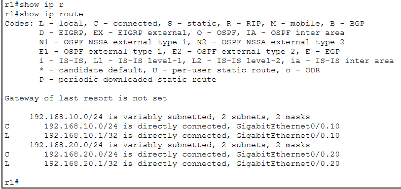
*r1 : réseaux 192.168.10.0/24 et 192.168.20.0/24 directement connectés (`show ip route`).*

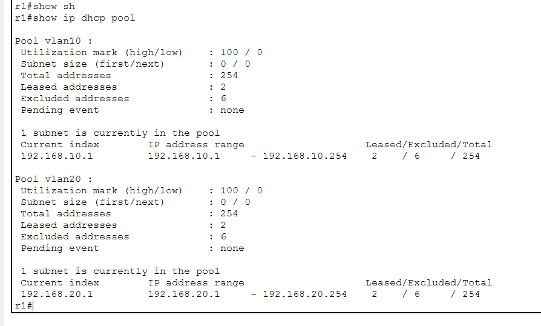
*Un pool DHCP par VLAN, 2 baux dans chacun (`show ip dhcp pool`).*

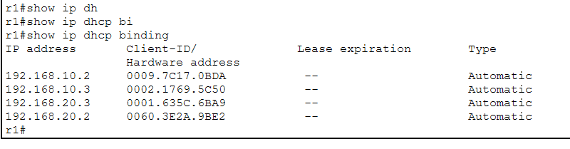
*Les quatre postes ont reçu leur adresse du routeur (`show ip dhcp binding`).*

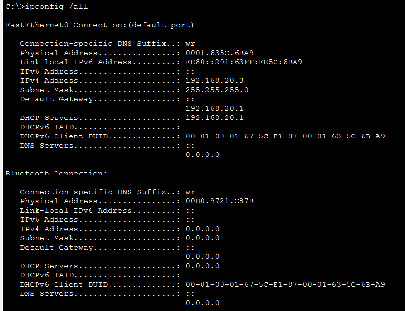
*PC2 : 192.168.20.3, passerelle et serveur DHCP 192.168.20.1 (`ipconfig /all`).*


### Communication et contrôle d'accès

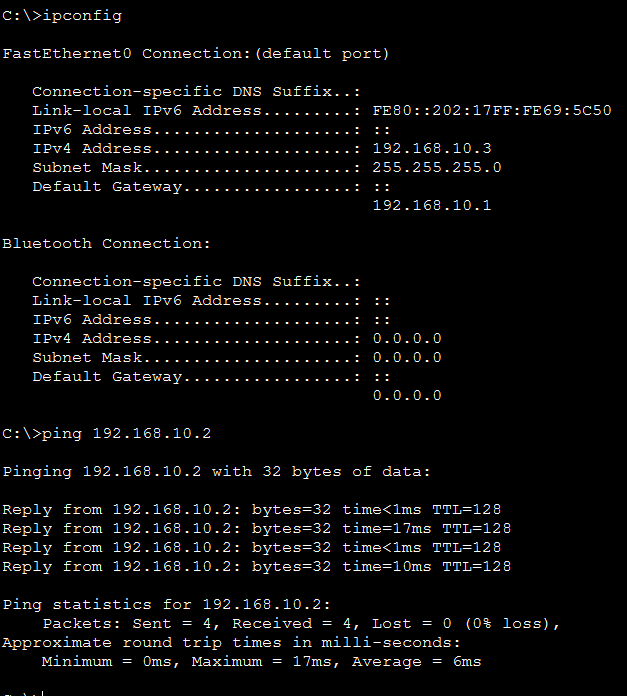
*PC3 vers PC1 : même VLAN, deux switches, 0 % de perte. Le trunk fonctionne.*

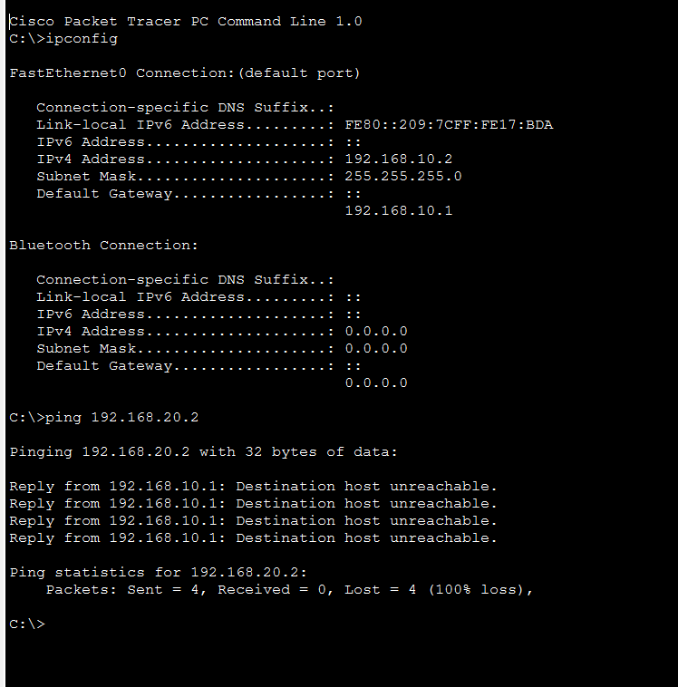
*PC1 vers PC4 : refusé par le routeur (« Destination host unreachable » renvoyé par 192.168.10.1). L'ACL agit.*

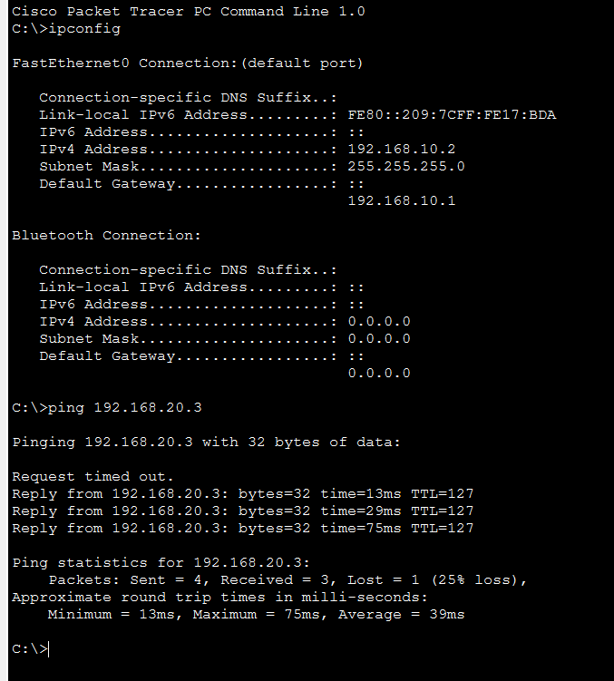
*PC1 vers PC2 : réussi, TTL 127 donc passage par le routeur. Seul PC4 est bloqué.*

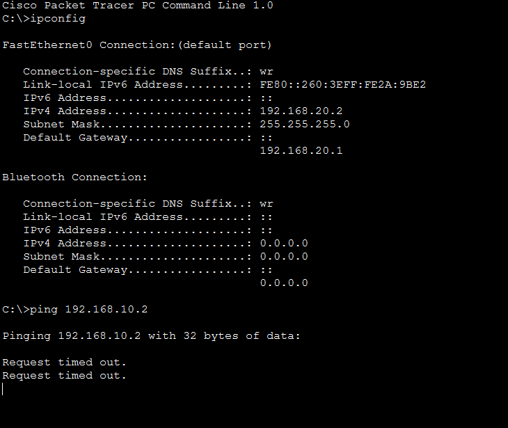
*PC4 vers PC1 : sans réponse, le flux est coupé dans les deux sens.*


### Administration sécurisée

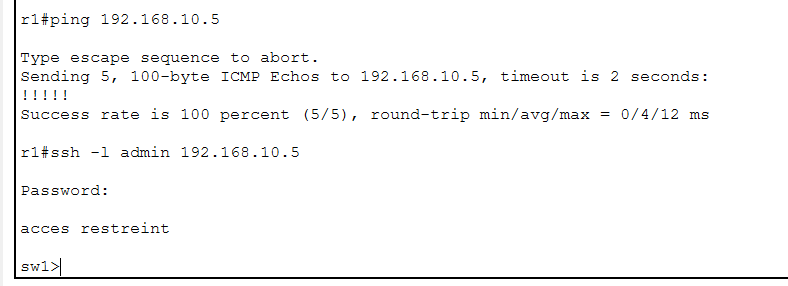
*Depuis r1 : ping du switch, puis connexion SSH vers sw1 (`ssh -l admin 192.168.10.5`).*

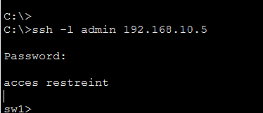
*Connexion SSH réussie vers le switch : bannière d'accès restreint, puis invite sw1.*

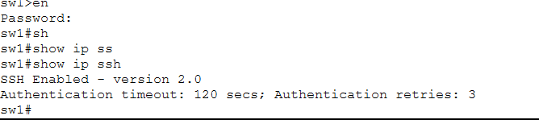
*sw1 : SSH activé en version 2.0 (`show ip ssh`).*


### Dépannage de l'ACL

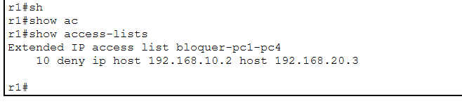
*Avant correction : la règle 10 visait 192.168.20.3.*

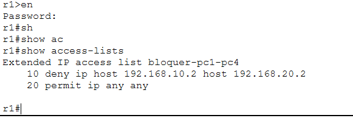
*Après correction : règle 10 vers 192.168.20.2 (PC4) et règle 20 `permit ip any any`.*

## Incidents diagnostiqués
| Symptôme | Cause | Solution |
|---|---|---|
| Pas de communication inter-VLAN | Une passerelle différente saisie sur chaque switch | Même passerelle pour tout un VLAN : la sous-interface du routeur |
| L'ACL ne protège pas le bon poste | La règle visait 192.168.20.3, adresse attribuée à PC2 | Règle réécrite avec l'adresse relevée par `ipconfig` sur PC4 |
| PC1 et PC3 sans adresse DHCP | Le `deny any` implicite bloquait le VLAN 10 | Ajout de `20 permit ip any any`, puis renouvellement des adresses |
| « Invalid input detected » | Faute de frappe, mot-clé manquant, plusieurs commandes sur une ligne | Une commande par ligne, lecture du marqueur `^` |

## Compétences
Segmentation VLAN, trunk 802.1Q, router-on-a-stick, DHCP, ACL étendues, SSH v2, diagnostic avec les commandes `show`, documentation technique.

## Auteur
Yves Guidebe Martial - [GitHub](https://github.com/yves-guidebe)
